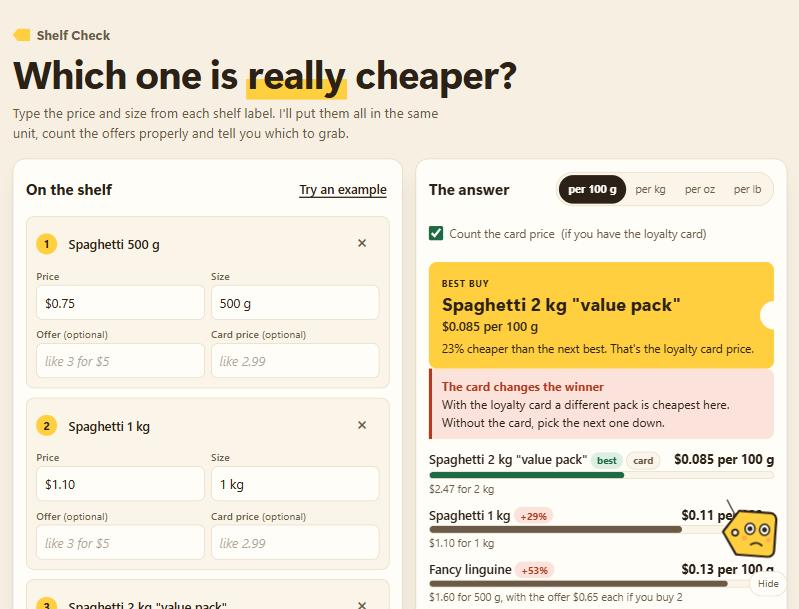

# Shelf Check

**Which one is really cheaper?** Type what each shelf label says (price, size, and any offer) and Shelf Check puts every item in the same unit, counts the offers properly and tells you which to grab.

Live: https://shelf-check.johanthegoat.xyz



## The problem

Bigger is not always cheaper. A 2026 study of 38 New Zealand supermarkets found that about a quarter of products sold in several sizes had a bigger pack that cost more per unit, in line with the 10 to 30% seen in other countries. Which? found a 2 kg spaghetti bag labelled "Bigger Pack Better Value" that cost 27p more than two 1 kg bags.

The shelf's own unit price does not always help either. New Jersey fined Walmart $1.64M in 2024 after inspectors found over 2,000 tags using the wrong unit, with similar products priced per can, per pound or per 100-count. And unit prices usually ignore multi-buy offers.

So people do the maths in their head in the aisle, or give up and guess. Sources are in [docs/research-notes.md](docs/research-notes.md).

## What it does

- Reads sizes the way labels print them: `500 g`, `1.5 kg`, `16 oz`, `2 lb 4 oz`, `1/2 gal`, `750 ml`, `12 fl oz`, `6 x 330 ml`, `12 rolls`, `30 pods`.
- Reads packs of packs: `12 mega rolls x 320 sheets`, `6 rolls, 268 sheets each`, `6 cans x 12 fl oz`. Toilet paper is compared per 100 sheets, because a "mega roll" means a different number of regular rolls from brand to brand (Charmin sells 1 Mega as 4 regular and 6 Mega XL as 36, per [these](https://www.walmart.com/ip/Charmin-Toilet-Paper-Ultra-Soft-6-Mega-XL-Rolls/3491999312) [listings](https://www.walmart.com/ip/Cottonelle-Ultra-ComfortCare-2-Ply-Standard-Toilet-Paper-White-268-Sheets-Roll-6-Mega-Rolls-Pack/5335376087)). A pack that only says rolls is left out with a note asking for the sheets per roll.
- Reads prices in common styles: `$3.49`, `3,49 €`, `1.299,00 €`, `£1`, `99p`, `₱1,250.50`, `Rs. 120`.
- Reads offers: `3 for $5`, `2/$5`, `3 for 2` (pay for two), `buy 2 get 1 free`, `B2G1`, `BOGO`, `buy one get one 50% off`, `buy 3 save $2`, `2nd half price`, `20% off`, `$1 off`, `save 50p`, and tells you how many you must buy to get the price.
- Ranks everything by price per unit and lets you switch between per 100 g, kg, oz and lb (or 100 ml, litre, fl oz, gallon). It starts in the unit your labels use.
- Counts a loyalty or member price if you type one and tick the box. It ranks on the price you would actually pay (the lower of the shelf deal and the card price) and flags when the card changes which pack is the best buy. The CMA's November 2024 review found loyalty prices across five UK supermarkets saved members 17% to 25% on average, yet 40% of shoppers did not trust they were a real saving, so seeing the real best buy with the card in hand matters.
- Warns about the two shelf traps: a bigger pack that costs more per unit than a smaller one, and an offer that still loses to something else.
- Shows what the cheaper pick saves in a year at how often you buy it.
- Leaves out an item sold by a different kind of unit (weight vs volume) and says why, instead of guessing.
- Installs to the home screen as a PWA, with a service worker caching the app shell.

## Tag, the mascot

Tag is a price tag who sits in the corner. Tag's eyes follow your pointer, or the field you are typing in on a phone. Tag thinks while you type, cheers at a clear best buy, frowns at a shelf trap and points it out in a speech bubble, and gives a tip that fits the moment when tapped. Everything Tag says is read out by screen readers. Tag can be hidden with one tap (and stays hidden), and keeps still when your device asks for reduced motion.

## Run it

It is a static page with no build step and no dependencies.

```bash
npx serve .
```

Or open `index.html` directly. Tests use Node's built-in runner:

```bash
npm test
```

## How it is built

- `src/engine.js` holds all the parsing and maths with no DOM, wrapped so the same file runs in the page and under `node --test`.
- Sizes convert to a base unit (grams, millilitres or items) using exact factors (1 oz = 28.349523125 g, 1 US fl oz = 29.5735295625 ml).
- Items within 1% of each other count as a tie, so rounding on a label never decides the winner.
- `src/app.js` renders the form and the answer. `src/tag.js` is the mascot. `sw.js` caches the page for offline use, network first so updates arrive.

## License

MIT, see [LICENSE](LICENSE).
